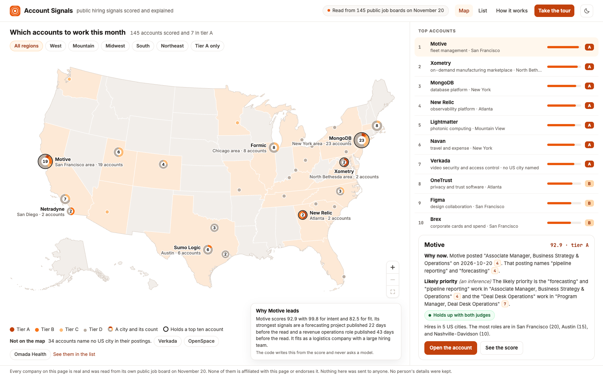
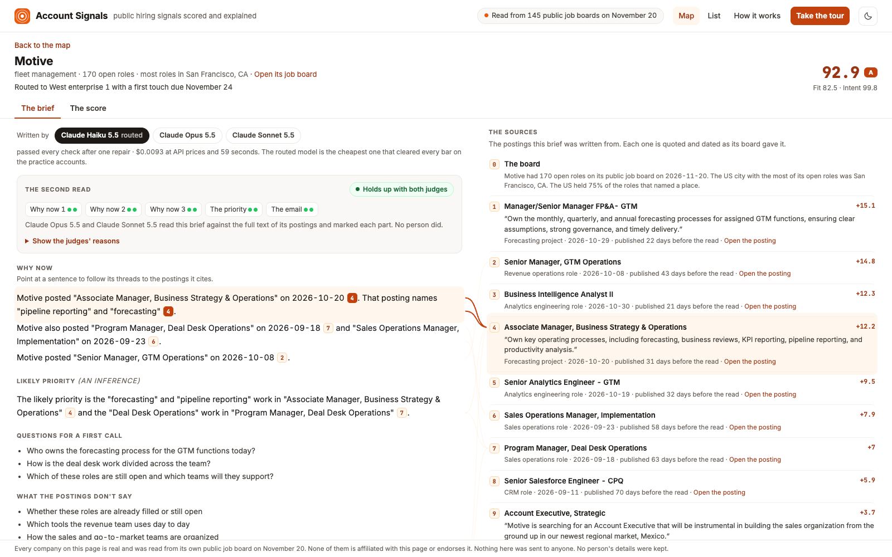
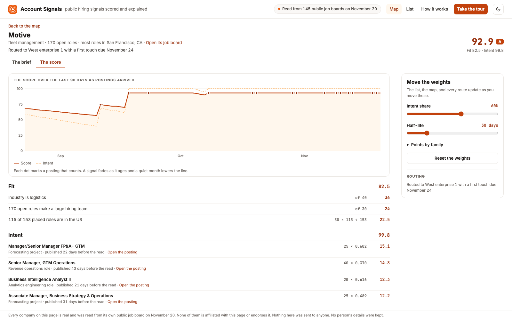
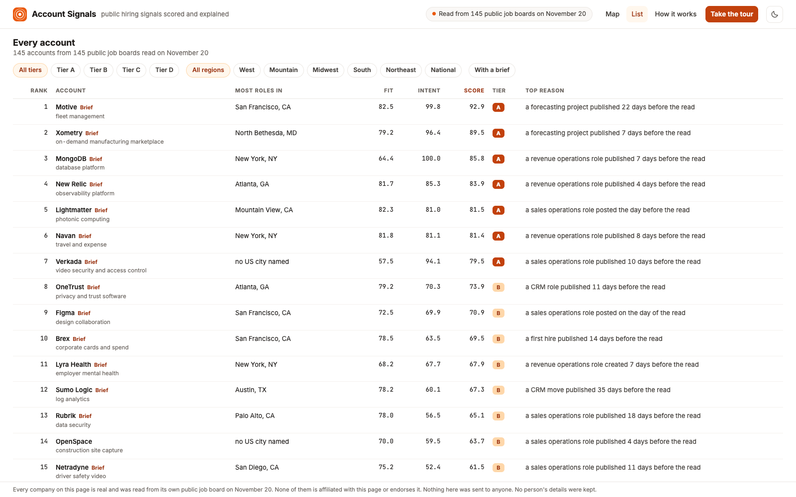
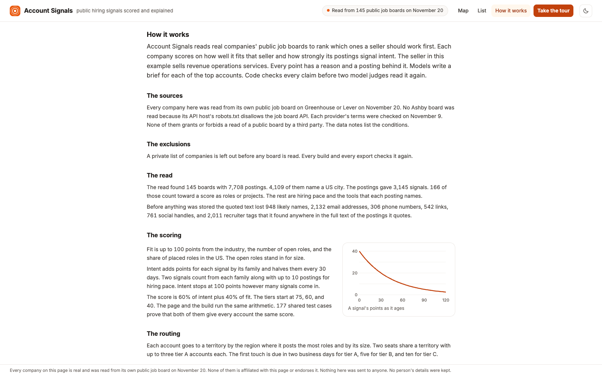
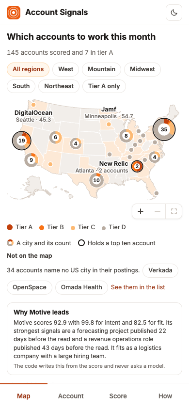
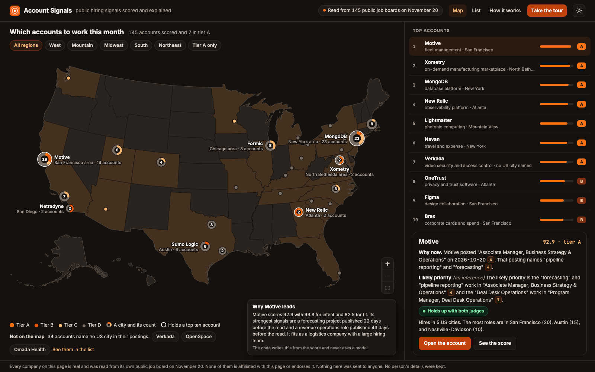

# Account Signals

Account Signals reads real companies' public job boards to rank the accounts a seller should work first. Every point of every score has a reason and a posting behind it. The page maps where each company hires and routes it to a territory with a first-touch deadline. Three Claude models write a cited research brief and a first email for the top accounts. Code checks every claim against the postings before two of the models read each brief again as judges. The seller in this example sells revenue operations services. It works at the company level only and nothing is ever sent.

See it live at [ryansansbury.com/account-signals](https://www.ryansansbury.com/account-signals/).



## What it does

- **The read.** An owner script reads each company's public job board through the API its applicant tracking system offers for that purpose. It honors each host's robots.txt and keeps to the conditions in DATA.md.
- **The signals.** Keyword rules find intent in each posting. A revenue operations role, a forecasting project, a CRM move, and a new territory each count as one. Every signal keeps its quote, its date, and its link.
- **The score.** Fit comes from the industry, the open roles, and the share of roles in the US. Intent comes from the signals. Each one loses half its points every 30 days. The page runs the same arithmetic as the build and re-ranks live as the weights move.
- **The map and the routes.** Each account sits at the city where it posts the most roles. The routing rules give it a territory, a seat, and a date for the first touch.
- **The briefs.** Claude Opus 5.5, Claude Sonnet 5.5, and Claude Haiku 5.5 write a brief for every one of the top 23 accounts from its own postings alone. Every sentence cites the postings it rests on.
- **The checks.** A claim checker reads every number, date, name, tool, and quote against the cited postings. It runs in Python for the build and in JavaScript on the page. An edited email runs through the same checks as you type.
- **The second read.** Two model judges read each brief against the full text of its postings. They mark each part as holding up, overreaching, or wrong. A brief holds up only when both agree. The judges are Opus and Sonnet.
- **The design.** The page fits one window on a desktop with a dark mode beside the light one. A phone gets the map, the account, and the score as three screens with a tab bar.

## The last run

The last read covered 145 public job boards on November 20 with 7,708 postings. It found 3,145 signals. 166 of them count toward a score as roles or projects.

| Model | Passed on the first try | Needs review | Holds up with both judges | API price a brief | Seconds a brief |
|---|---|---|---|---|---|
| Claude Opus 5.5 | 18 of 23 | 0 | 13 of 23 | $0.1070 | 24.1 |
| Claude Sonnet 5.5 | 11 of 23 | 0 | 18 of 23 | $0.0697 | 23.6 |
| Claude Haiku 5.5 (routed) | 13 of 23 | 2 | 20 of 23 | $0.0072 | 47.5 |

Every call ran through the Claude Code command line on a Claude plan. Each price is what the same calls would bill through the API.

The judges caught 9 of the 9 errors planted in copies of other briefs. That's the test their read had to pass to count. 20 of the routed model's 23 briefs hold up with both judges where the bar is 21. That's short of the bar. The page shows every brief's verdict with the judges' reasons.

## Run it

The build and the tests use Python 3.9 or later with the standard library alone. The page's own checks run under Node. The page is static and opens from the file system.

```
python3 -m engine.rank
python3 build.py
python3 tests/run.py
python3 owner/preview_site.py
```

The read and the model runs are owner scripts. owner/README.md gives their order. The recorded runs ship with the repo. The page rebuilds from them without an account or a network.

## Where things are

| Folder | What it holds |
|---|---|
| `engine/` | the board parsers, redaction, the signals, the scoring, the routing, the map's projection, and the claim checker |
| `agents/` | the model layer, the brief's inputs, its validation, the replay, and the judges |
| `evals/` | the scoreboard, the freeze, and the record of each tuning round |
| `prompts/` | the brief's prompt and the judge's prompt |
| `app/` and `site/` | the build's page, its words, its bundle, and the page's scripts |
| `owner/` | the scripts that read the boards, record the briefs, run the judges, and take the screens |
| `data/` | the redacted snapshot, the ranking, and the recorded runs |
| `tests/` | the unit tests, the parity vectors, and the page's click-through |

## Read more

- [DATA.md](DATA.md) gives the sources, their terms, and what never leaves the build machine.
- [docs/DECISIONS.md](docs/DECISIONS.md) records every rule or number changed after the data was seen.

## Screens

An account's brief with each citation threaded to the posting it rests on, the second read, and the first touch with its live check.



The score's chart and the arithmetic behind every point beside the weights that re-rank the page.



Every account with its fit, intent, score, tier, and top reason.



How it works from the sources with their terms to the scoreboard and the code.



The phone's three screens with the tab bar on one line.



The map in dark mode with the same tiers and rings.



## License

The code is released under the PolyForm Noncommercial License 1.0.0. It allows any noncommercial use. The companies' postings belong to them. The page links each quote to its posting.
